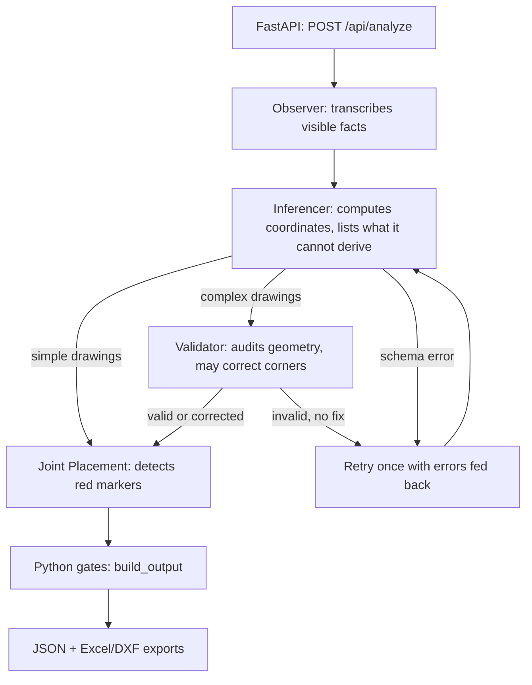

# Structural Section Geometry Extractor

A FastAPI + LangGraph pipeline that turns an image of a 2D structural section drawing (I, T, L, C, U and compound sections) into machine-readable geometry: corner coordinates, boundary segments, rectangular structural components, and joint locations marked by red lines on the drawing.

The output is meant to feed engineering calculations such as centroid and moment of inertia. Plausible but wrong geometry is worse than none, so the system's core rule is: **geometry may come only from labelled dimensions and arithmetic on them.** When a drawing doesn't contain enough dimensions, the system says which one is missing instead of guessing.

Built during an AI engineering internship (May–June 2026).

---

## How it works

Four Gemini 2.5 Flash calls, each with one responsibility, orchestrated as a LangGraph state graph. Python code makes the final decisions.



| Stage | Type | Responsibility |
|---|---|---|
| **Observer** | LLM | Reports only what is visible: section type, unit (or `"unspecified"`), every labelled dimension and where it sits, topology, simple/complex. No arithmetic, no joints. |
| **Inferencer** | LLM | Computes corners, segments and components using explicit dimensions and arithmetic only, recording each step. Anything it cannot derive goes into a structured `assumptions` list instead of being guessed. |
| **Validator** | LLM | Audits the geometry against the drawing (complex sections only). Can return corrected corners or trigger the single retry. |
| **Joint Placement** | LLM | Runs after geometry is frozen. Detects red marker lines from the image and reports them in the geometry's coordinate frame. |
| **`build_output`** | Python | Blocks the geometry if any assumption was declared, naming the missing dimensions. Runs Shapely component-tiling and union-find determinacy checks (currently advisory warnings). |

### Design decisions

- **Perception is separated from computation.** A single-prompt version worked on textbook shapes only because it silently assumed symmetry and centring. Splitting the stages makes "what's on the page" inspectable separately from "what was computed", and gives the model a structured place to declare what it couldn't derive.
- **Joint detection is isolated from geometry.** Letting the perception stage know about joints leaked joint data into the geometry. Joint detection is now a separate call after the geometry loop ends. Its schema declares only `joints`, the graph has no edge back into the geometry stages, and on any failure it returns an empty list rather than raising.
- **Every stage has a Pydantic contract.** Model output is requested in JSON mode at temperature 0 and validated before the next stage uses it. Perception failures stop the request. Inferencer failures get one corrective retry. A malformed Validator response is treated as a pass, so a broken auditor can't loop the pipeline.
- **Retries by failure class.** HTTP 503/429 are retried up to 3 attempts using the server's suggested delay. Timeouts are not retried. The read timeout is 300 s because generation time grows with output size. Every call logs finish reason, token counts and latency.

### Current limitations

- The Inferencer LLM computes the coordinates; Python verifies and can veto them but does not compute them. A deterministic Shapely-based rebuild (`geometry/render.py`) exists but is not wired in.
- The blocking gate relies on the model reporting its own assumptions. The independent tiling and determinacy checks are warning-only until calibrated.
- There is no automated test suite or benchmark. Testing was manual, against a small set of drawings run at least twice each, so no accuracy figure is claimed.
- The frontend renders corners and segments only; components and joints are in the JSON response. Excel/DXF exports contain corners and segments.

---

## Project structure

```
backend/
  main.py                FastAPI app: POST /api/analyze, GET /api/health
  pipeline.py            LangGraph graph, routing, retry loop, build_output
  schemas.py             Pydantic contracts for every stage
  exporters.py           Excel (openpyxl) and DXF (ezdxf) generation
  agents/
    gemini_caller.py     Gemini REST client: retries, timeouts, token/latency logging
    observer.py          Stage 1: perception
    inferencer.py        Stage 2: geometry
    validator.py         Stage 3: audit (complex sections only)
    joint_placement.py   Stage 4: red-marker detection, after geometry is frozen
  prompts/               One prompt per stage
  geometry/
    validity.py          Assumptions gate + Shapely tiling check
    determinacy.py       Union-find determinacy check (warning-only)
frontend/                Next.js: upload, canvas diagram, tables, downloads
```

---

## Running locally

**Backend** (Python 3.10+)

```bash
cd backend
python -m venv venv
source venv/bin/activate        # Windows: venv\Scripts\activate
pip install -r requirements.txt
```

Create `backend/.env`:

```
GEMINI_API_KEY=your_api_key_here
```

```bash
uvicorn main:app --reload --port 8000
curl -X POST http://localhost:8000/api/analyze -F "file=@drawing.png;type=image/png"
```

**Frontend** (Node 18+)

```bash
cd frontend
npm install
npm run dev
```

Create `frontend/.env.local`:

```
NEXT_PUBLIC_API_URL=http://localhost:8000
```

---

## API

`POST /api/analyze` accepts `multipart/form-data` with a `file` field (PNG, JPEG or WebP, max 10 MB).

```json
{
  "analysis": {
    "section_type": "U-section",
    "unit": "mm",
    "dimensions_read": { "overall_width": 200, "web_thickness": 20 },
    "corners": [{ "label": "A", "x": 0, "y": 150 }],
    "line_segments": [{ "number": 1, "end1": "A", "end2": "B" }],
    "components": [{ "name": "left_leg", "bottomX": 0, "bottomY": 0, "breadth": 20, "depth": 150 }],
    "joints": [{ "name": "J1", "start": { "x": 0, "y": 60 }, "end": { "x": 20, "y": 60 } }],
    "warnings": []
  },
  "exports": { "excel_b64": "...", "dxf_b64": "..." }
}
```

- Origin `(0, 0)` is the section's leftmost and bottommost extent; there are no negative coordinates.
- If the drawing is under-constrained, `corners`, `line_segments`, `components` and `joints` are empty and `warnings` names the missing dimensions.
- Errors: `400` for a bad upload, `422` for a pipeline validation failure, `500` otherwise.

`GET /api/health` returns `{ "status": "ok" }`.
